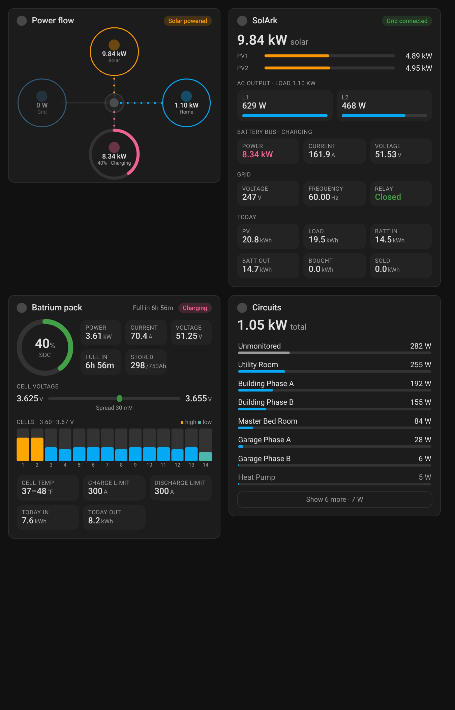
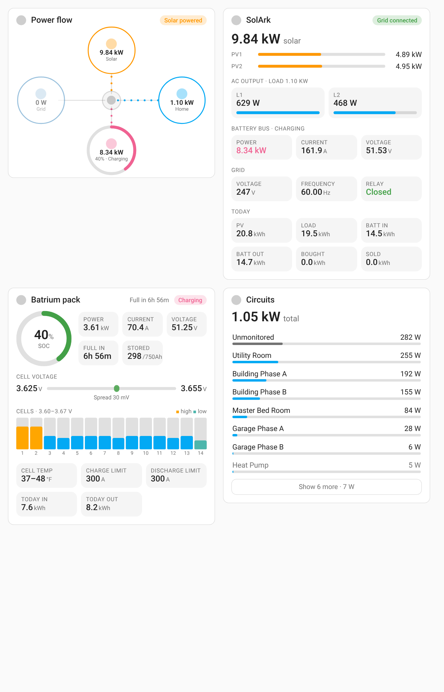

# krogo energy cards

A matching set of Home Assistant Lovelace cards for a home energy system: a live power flow, an inverter card, battery bank cards and a circuits card. They were built for a SolArk inverter, a Batrium BMS and an Emporia Vue, but every entity is set in YAML, so any inverter, BMS or power monitor that exposes the same kinds of sensors will work.

| Dark | Light |
|------|-------|
|  |  |

Each card is independent. Place, size and arrange them as you like, or group them in a vertical stack or grid card.

## Install

**HACS (recommended):** HACS → ⋮ → Custom repositories → add `https://github.com/krogo/HACS_Solark_Batrium_Emporia_Flow` with type **Dashboard**. Install "krogo energy cards", then hard-refresh your browser. HACS adds the resource and offers updates when a new release is published.

**Manual:** copy `krogo-energy-cards.js` to `/config/www/`, add `/local/krogo-energy-cards.js?v=1` as a JavaScript module resource (Settings → Dashboards → ⋮ → Resources), and hard-refresh. Bump `?v=` after each update.

## Adding a card

Edit dashboard → Add card → search **krogo**. Each card starts with sensors it finds automatically (SolArk-, Batrium- and Emporia-style names, preferring sensors that are actually updating), and the visual editor lets you change any of them. Everything in the editor can also be written in YAML, and YAML-only options (custom names, cell lists, extra tiles) are kept when you use the editor.

If a card shows "No sensors set yet", open its editor and pick the sensors.

If the card isn't in the picker after installing through HACS, check that the resource is registered (Settings → Dashboards → ⋮ → Resources): HACS can only add it when resources are managed in the UI, not with `lovelace: resource_mode: yaml`. Add `/hacsfiles/HACS_Solark_Batrium_Emporia_Flow/krogo-energy-cards.js` as a JavaScript module if it's missing.

## Common rules

- An entity can be written as `sensor.x` or as `{ entity: sensor.x, invert: true, name: ... }`.
- **Units are read from the sensor**: W / kW, V / mV, Wh / kWh / MWh, °C / °F. Mixing sources is fine.
- **Sign conventions**: power is expected as + charging (battery) and + importing (grid). Add `invert: true` to any source that reports the other way round. SolArk reports battery power and current negative while charging, so both need `invert: true`.
- Clicking any value opens Home Assistant's more-info dialog for that sensor.
- Anything you leave out is simply not shown.

## Cards

### `custom:energy-flow-card`

Live power between solar, grid, home and battery. Dots move faster as power rises and reverse with the direction of flow. The header shows what is mainly powering the home.

```yaml
type: custom:energy-flow-card
title: Power flow
solar: { entity: sensor.solark_pv_input_power }
home: { entity: sensor.solark_load_power }
battery: { entity: sensor.solark_battery_power, invert: true, soc: sensor.batrium_soc_coulomb }
grid: { entity: sensor.solark_total_grid_power, relay: sensor.solark_grid_relay }
idle_threshold: 20        # W; below this a path is shown idle
```

`grid.relay` is optional. A state of open / off / disconnected shows the grid as off-grid.

### `custom:inverter-card`

PV strings, AC output legs, the inverter's view of the battery bus, grid status and today's energy totals.

```yaml
type: custom:inverter-card
title: SolArk
pv:
  total: sensor.solark_pv_input_power      # optional; otherwise strings are summed
  capacity: 12000                          # optional W; scales the bars and shows % of capacity
  strings:                                 # any number
    - { entity: sensor.solark_pv1_input_power, name: PV1 }
    - { entity: sensor.solark_pv2_input_power, name: PV2 }
    - { entity: sensor.solark_pv3_input_power, name: PV3 }
  show_missing: false                      # strings whose sensor doesn't exist are hidden unless true
legs:
  - { entity: sensor.solark_inverter_l1_power, name: L1 }
  - { entity: sensor.solark_inverter_l2_power, name: L2 }
load: sensor.solark_load_power
battery:
  power: { entity: sensor.solark_battery_power, invert: true }
  current: { entity: sensor.solark_battery_current, invert: true }
  voltage: sensor.solark_battery_voltage
grid:
  voltage: sensor.solark_grid_l1_l2_voltage
  frequency: sensor.solark_grid_frequency
  relay: sensor.solark_grid_relay
  nominal_hz: 60                           # frequency shown in warning colour beyond ±0.5 Hz
today:                                     # any energy sensors
  - { entity: sensor.solark_daily_pv_energy, name: PV }
  - { entity: sensor.solark_daily_load_energy, name: Load }
```

### `custom:battery-bank-card`

One card per bank: SOC ring, power, current, voltage, time to full/empty, Ah stored, cell voltage spread, per-cell bars with the highest and lowest highlighted, temperatures, limits and today's energy. Every entity except `soc` or `power` is optional.

```yaml
type: custom:battery-bank-card
name: Batrium pack
icon: mdi:car-battery
entities:
  soc: sensor.batrium_soc_coulomb
  power: sensor.batrium_pack_power           # + = charging
  current: sensor.batrium_shunt_current
  voltage: sensor.batrium_pack_voltage
  time_to_full: sensor.batrium_estimated_time_to_full      # minutes; negative = not applicable
  time_to_empty: sensor.batrium_estimated_time_to_empty
  capacity_to_full: sensor.batrium_capacity_to_full        # Ah
  capacity_to_empty: sensor.batrium_capacity_to_empty      # Ah; with both, shows stored / total
  cell_min: sensor.batrium_cell_voltage_min
  cell_max: sensor.batrium_cell_voltage_max
  temp_min: sensor.batrium_cell_temp_min
  temp_max: sensor.batrium_cell_temp_max
  charge_limit: sensor.batrium_charger_target_current
  discharge_limit: sensor.batrium_inverter_target_current
  energy_in: sensor.batrium_today_energy_in
  energy_out: sensor.batrium_today_energy_out
cells:                       # optional: a list of entities, or a pattern + count
  pattern: sensor.batrium_cell_{n}_voltage
  count: 14
cell_range: [3.0, 4.2]       # V; scale of the spread bar
spread_warn: 0.05            # V; spread shown in warning colour above this
```

### `custom:circuits-card`

Circuit power sorted by load, with the largest first and the rest behind "Show more".

```yaml
type: custom:circuits-card
title: Circuits
total: sensor.emporiavue2_total_power        # optional; header and bar scale
balance: sensor.emporiavue2_balance_power    # optional; listed as "Unmonitored"
strip: "vue2 "                               # removed from the start of names
max: 8                                       # rows before "Show more"
hide_below: 0                                # W; smaller rows fold into "Show more"
entities:
  - sensor.emporiavue2_heat_pump_power
  - { entity: sensor.emporiavue2_kitchen_south_dishwasher_power_2, name: Kitchen / DW }
# instead of (or as well as) entities:
# match: "^sensor\\.emporiavue2_.*_power$"   # every W/kW sensor whose id matches
# auto: emporia_vue                          # every W/kW sensor from this integration
# exclude: [sensor.emporiavue2_phase_a_power]
```

## Tests

`tests/` holds a mock Home Assistant page and Playwright scripts that render the cards from recorded states. Run them from the repository root, e.g. `python3 tests/shot.py`. They need Python Playwright and a local Chrome.

## License

MIT
